I like to explore new technologies and develop software solutions. 

Tricks and puzzles of any form are my true passion. 

That's why when I do not look like 👨🏻‍💻 I enjoy reading about psychology🧠🧐 and learning some magic🧙♠️

#### 🛠 &nbsp;Tech Stack

